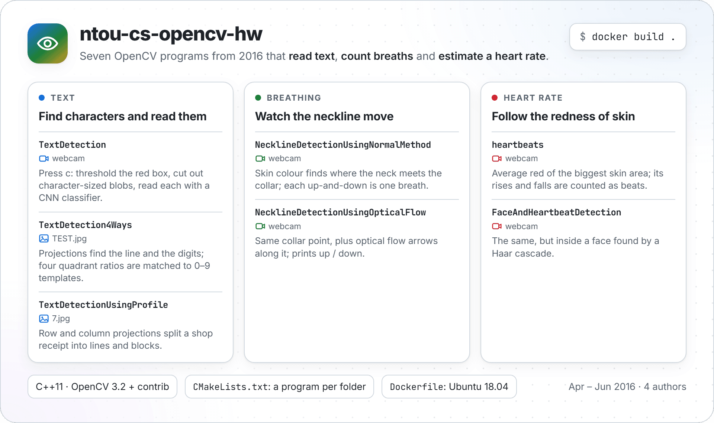
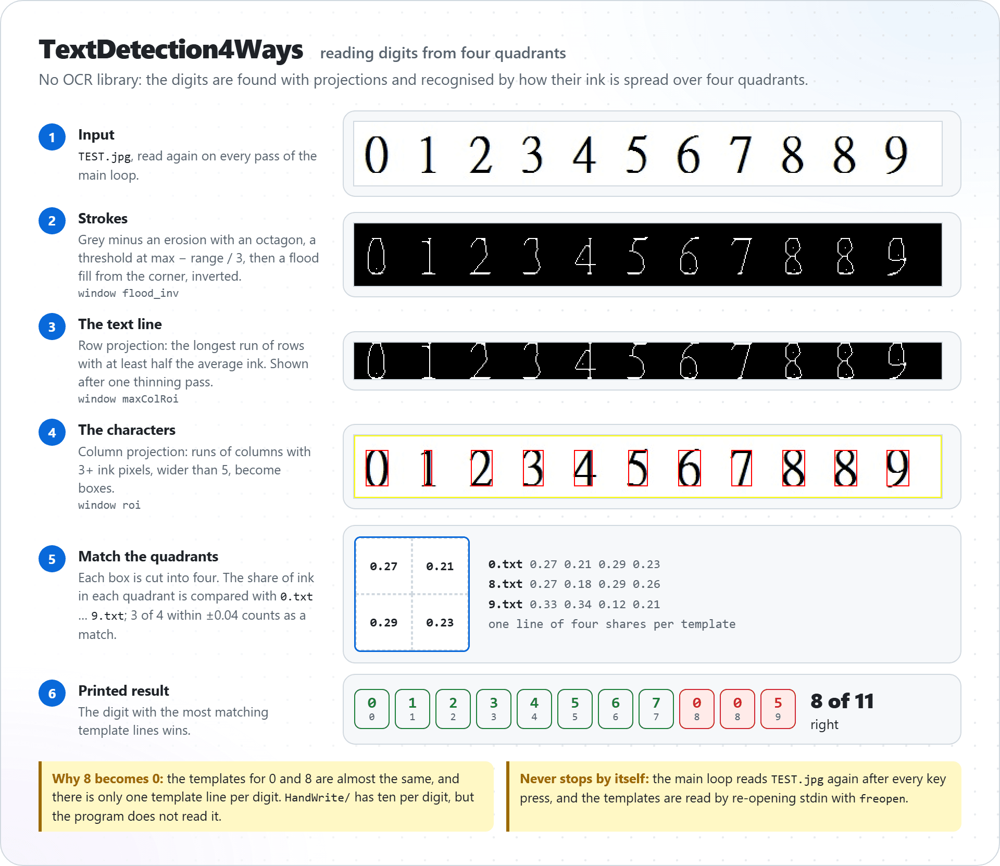
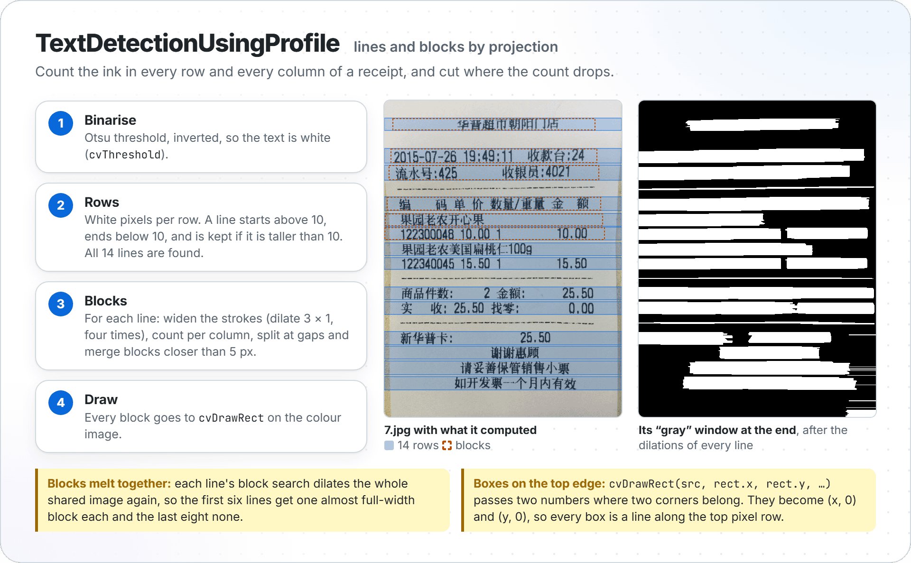
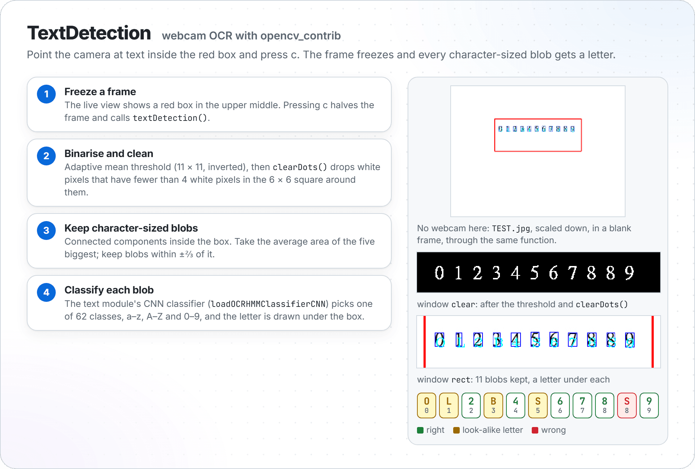
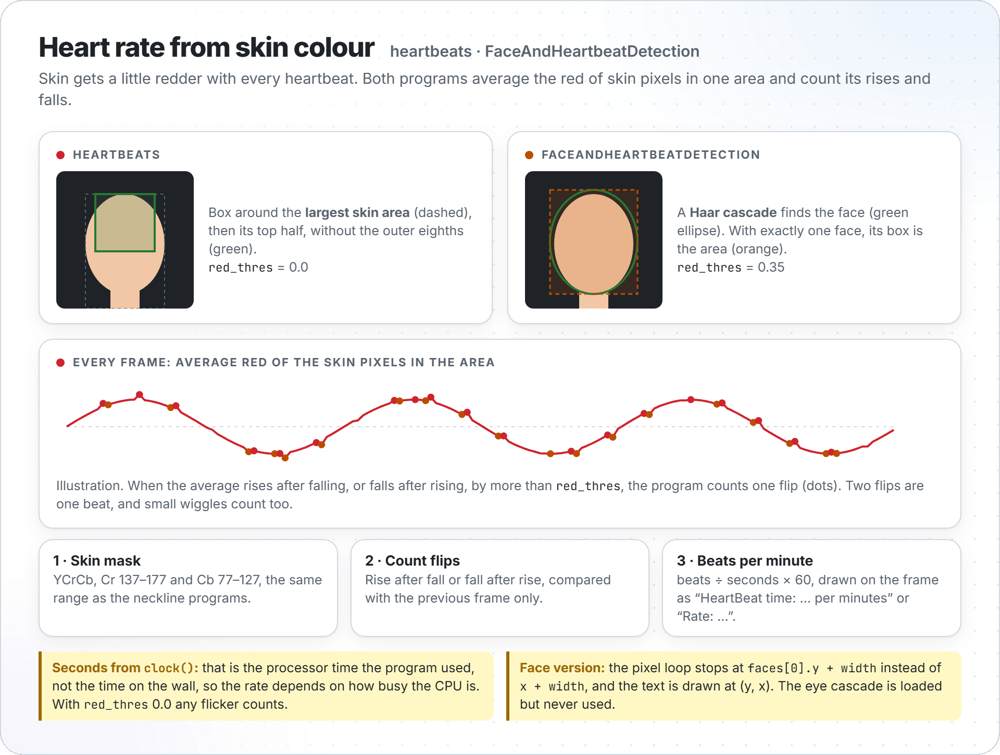

<p align="center">
  <picture>
    <source media="(prefers-color-scheme: dark)" srcset="docs/images/hero-dark.png">
    
  </picture>
</p>

Seven small C++ programs written with [OpenCV](https://opencv.org/) for a group homework at National
Taiwan Ocean University (NTOU), Department of Computer Science and Engineering, between April and
June 2016. The commit history shows four authors: Nat (NatLee), WenShihKen, FinianWu and 張語航.
The programs try three things: reading text in an image, counting breaths by watching the neckline
on a webcam, and estimating a heart rate from the colour of skin.

The code is kept the way it was written, odd bits included. This README explains how each program
works, shows real results for the three that could be run here, and says how to build them today.

## Build

The programs were written in Visual Studio for OpenCV 3. They use OpenCV's old C API (`IplImage`,
`cvShowImage`, `cvCreateTrackbar`, …), which OpenCV 4 removed, and `TextDetection` needs the
`text` module from opencv_contrib. The easiest way to get that toolchain is the Dockerfile, which
uses Ubuntu 18.04, the last Ubuntu release that packages OpenCV 3 (3.2):

```sh
docker build -t ntou-cs-opencv-hw .     # builds all seven into /src/build in the image
```

With OpenCV 3 and its contrib modules installed yourself, CMake 3.10 or newer builds them natively:

```sh
mkdir build && cd build && cmake .. && make
```

Each folder becomes one program of the same name, e.g. `build/TextDetection4Ways`. CMake asks for
OpenCV 3, so pointing it at OpenCV 4 stops with a clear message. CI builds the Docker image on
every pull request and every push to `master`.

## Run

Start each program from its own folder, because it opens its input files by relative path:

```sh
cd TextDetection4Ways && ../build/TextDetection4Ways
```

| Program | Input | Also needs in its folder | Quit with |
| --- | --- | --- | --- |
| `TextDetection` | webcam | the OCR model files, see below | Ctrl+C |
| `TextDetection4Ways` | `TEST.jpg` | `0.txt` … `9.txt` (in the repo) | Ctrl+C |
| `TextDetectionUsingProfile` | `7.jpg` | — | any key |
| `NecklineDetectionUsingNormalMethod` | webcam | — | any key |
| `NecklineDetectionUsingOpticalFlow` | webcam | — | any key |
| `heartbeats` | webcam | — | any key |
| `FaceAndHeartbeatDetection` | webcam | two Haar cascade files, see below | Esc |

`TextDetection` uses the CNN character classifier and language model that ship with
opencv_contrib 3.2.0:

```sh
cd TextDetection
curl -LO https://raw.githubusercontent.com/opencv/opencv_contrib/3.2.0/modules/text/samples/OCRBeamSearch_CNN_model_data.xml.gz
curl -LO https://raw.githubusercontent.com/opencv/opencv_contrib/3.2.0/modules/text/samples/OCRHMM_transitions_table.xml
```

`FaceAndHeartbeatDetection` loads two of the Haar cascades that come with OpenCV. On Ubuntu they
are in the `opencv-data` package:

```sh
cp /usr/share/opencv/haarcascades/haarcascade_frontalface_alt.xml \
   /usr/share/opencv/haarcascades/haarcascade_eye_tree_eyeglasses.xml FaceAndHeartbeatDetection/
```

`.gitignore` keeps these downloaded files out of git. Without a webcam, the five camera programs
stop right away.

## Project layout

```text
.
├── TextDetection/                       webcam OCR: main.cpp, TextDetection.cpp, TEXTRecognizer.cpp
├── TextDetection4Ways/                  digits by quadrants: Source.cpp (includes thinning.cpp),
│   ├── TEST.jpg, 1.jpg                  the test image the code reads, and one more,
│   ├── 0.txt … 9.txt                    one template per digit,
│   └── HandWrite/                       and ten handwritten templates per digit (not read by the code)
├── TextDetectionUsingProfile/           lines by projection: Source.cpp and 7.jpg
├── NecklineDetectionUsingNormalMethod/  breathing: NecklineDetection.cpp
├── NecklineDetectionUsingOpticalFlow/   breathing with optical flow: NecklineOpticalFlow.cpp, find_collar.cpp
├── heartbeats/                          heart rate from the biggest skin area
├── FaceAndHeartbeatDetection/           heart rate inside a detected face
├── docs/images/                         README pictures; their HTML sources and render.sh are in src/
├── CMakeLists.txt                       one executable per folder
├── Dockerfile                           Ubuntu 18.04 + OpenCV 3.2 toolchain, used by CI
└── .github/workflows/build.yml          CI: builds the Docker image
```

## Reading text

### TextDetection4Ways: digits by quadrants

No OCR library here. The program finds the line of text and the characters with projections, then
recognises each digit by how its ink is spread over four quadrants, compared with one template per
digit. Every picture on the right is a window the program really shows.

<p align="center">
  <picture>
    <source media="(prefers-color-scheme: dark)" srcset="docs/images/text-4ways-dark.png">
    
  </picture>
</p>

```text
$ cd TextDetection4Ways && ../build/TextDetection4Ways
/////////////
0
1
2
3
4
5
6
7
0
0
5
```

`TEST.jpg` shows 0 1 2 3 4 5 6 7 8 8 9, so 8 of the 11 are right.

### TextDetectionUsingProfile: lines by projection

Counts the ink in every row of a shop receipt to find the lines, then in every column of each line
to find blocks.

<p align="center">
  <picture>
    <source media="(prefers-color-scheme: dark)" srcset="docs/images/text-profile-dark.png">
    
  </picture>
</p>

The row step finds all 14 lines of the receipt. The block step does not get far, and the program
draws its boxes in the wrong place; the two notes in the picture say why. The rows and blocks on the
left picture are the program's own numbers, printed by a copy of `Source.cpp` with two `printf`
lines added.

### TextDetection: webcam OCR

Shows the webcam with a red box. Hold some text inside it and press c: the frame freezes, and every
character-sized blob inside the box gets a letter from the CNN classifier in opencv_contrib's text
module. Press any other key to go back to the live view.

<p align="center">
  <picture>
    <source media="(prefers-color-scheme: dark)" srcset="docs/images/text-ocr-dark.png">
    
  </picture>
</p>

There was no webcam for this README, so the run in the picture put `TEST.jpg` (scaled to 300 px
wide) into a blank 640 × 480 frame and called the program's own `textDetection()` on it. The
classifier knows letters as well as digits, so 0, 1, 3 and 5 come out as O, L, B and S.

## Counting breaths

`NecklineDetectionUsingNormalMethod` and `NecklineDetectionUsingOpticalFlow` find the skin of the
neck and watch where it meets the collar. Breathing moves that line up and down.

<p align="center">
  <picture>
    <source media="(prefers-color-scheme: dark)" srcset="docs/images/breathing-dark.png">
    
  </picture>
</p>

Both need a webcam, so the picture is a schematic drawn from the code. The skin colour range can be
tuned with the trackbars in the Control window.

## Estimating a heart rate

`heartbeats` and `FaceAndHeartbeatDetection` average the red channel of the skin pixels in one area
of the frame and count how often that average turns from rising to falling and back.

<p align="center">
  <picture>
    <source media="(prefers-color-scheme: dark)" srcset="docs/images/heartbeat-dark.png">
    
  </picture>
</p>

This is a schematic as well; the curve is an illustration, not a measurement.

## Odd bits, kept as they were

The code was not changed to fix these. They are listed so the results above make sense.

| Program | What you see | Why |
| --- | --- | --- |
| TextDetection4Ways | both 8s read as 0, the 9 as 5 | one template per digit, and the 0 and 8 templates are nearly the same |
| TextDetection4Ways | never exits by itself | the main loop reads `TEST.jpg` again after every key |
| TextDetectionUsingProfile | no boxes on the receipt | `cvDrawRect(src, rect.x, rect.y, …)` gets two numbers instead of two corners, so each box is a line on the top pixel row |
| TextDetectionUsingProfile | blocks only for the first six lines | each line's block search dilates the whole image again |
| TextDetection | letters for digits (O, L, B, S) | the classifier has 62 classes: a–z, A–Z, 0–9 |
| heartbeats, FaceAndHeartbeatDetection | rate depends on CPU load | seconds come from `clock()`, the processor time used |
| FaceAndHeartbeatDetection | only part of the face is averaged | the pixel loop stops at `faces[0].y + width` instead of `x + width` |
| both neckline programs | dragging HighCb moves the low bound | the trackbar is tied to `&LCb` |

## History

Written between 2016-04-24 and 2016-06-29 in Visual Studio with OpenCV 3; the project files were
never committed. In 2026 two Visual C++-only spots were replaced with standard C++ (a `for each`
loop and an include path), two Big5-encoded files were converted to UTF-8, and CMake, a Docker
toolchain, CI and this README were added. Nothing else in the programs changed.

## License

[MIT](LICENSE)
